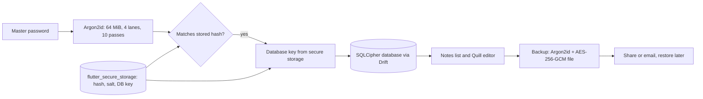

# Notally

A secure, offline, encrypted notebook for Android (built with Flutter). Notes never leave the device unless you export an encrypted backup yourself.

**Links:** [GitHub](https://github.com/shriram-s7/Notally)

## Overview

Notally is a notebook for people who do not want their notes on anyone else's server. Everything is stored locally in an encrypted database that is unlocked with a master password; there is no account, no cloud sync and no network access needed. The only way notes leave the phone is an encrypted backup file that you export yourself. It is a personal Flutter project targeting Android.

## Features

- **Master-password lock** with first-run setup; the password is stretched with **Argon2id**. Biometric unlock is supported through the platform (`local_auth`).
- **Encrypted local database**: notes are stored in SQLite encrypted with SQLCipher (`sqlcipher_flutter_libs`) using Drift as the data layer.
- **Rich-text notes** with the Flutter Quill editor; note list and edit screens.
- **Encrypted backup and restore**: export a backup file protected with Argon2id + AES-256-GCM, share or email it, and restore it later with the backup password (the app verifies it before restoring).
- **Change master password** from Settings.
- Secrets (key material) are kept in the platform secure storage (`flutter_secure_storage`).

## How it works



On first run you set a master password. Its Argon2id hash and salt, and a random database key, are kept in the platform secure storage. Unlocking verifies the password and then opens the SQLCipher database with that key (HMAC-SHA512, PBKDF2-SHA512, 4096-byte pages). Backups are encrypted separately with a key derived from the backup password.

## Stack

Flutter / Dart, Riverpod (state), go_router (navigation), Drift + SQLCipher (storage), `cryptography` (Argon2id, AES-GCM), `flutter_secure_storage`, `local_auth`, `flutter_quill`, `share_plus`, `file_picker`.

## Run it

Requires the Flutter SDK (Dart 3.12+) and an Android device or emulator.

```bash
flutter pub get
dart run build_runner build --delete-conflicting-outputs   # regenerates Drift code if needed
flutter run
```

Run the tests with `flutter test`. The `flutter_quill` dependency is taken from its Git `master` branch, so the first `flutter pub get` needs network access.

There is no `.env` file or other configuration.

## Usage

1. Open the app and create a master password (it cannot be recovered).
2. Add notes with the rich-text editor; they appear in the note list.
3. In Settings you can change the master password and create or restore an encrypted backup.

## Tests

Unit tests cover the auth repository, the crypto service and the backup service (`test/unit/`), plus a widget test. Flutter is not installed on the machine used to write this README, so the tests were **not run** and no pass count is claimed.

## Structure

```
lib/
  main.dart
  core/                 app widget, router, theme, startup and security utilities
  features/
    auth/               lock and setup screens, Argon2id crypto service, secure storage
    notes/              Drift database, repository, list and edit screens
    settings/           change password, encrypted backup and restore
```

## Status and limitations

- Working Android prototype of the core flow: lock, notes, change password, encrypted backup and restore.
- Android only; no iOS, desktop or web targets are present in the repository.
- No cloud sync or account, by design.
- Not independently security-reviewed. Treat it as a personal project rather than an audited vault.

## Security notes

- There is no cloud sync and no account; losing the master password means the notes cannot be recovered.
- Do not commit `android/key.properties`, keystores or `local.properties`; they are git-ignored.

## License

No license specified.
